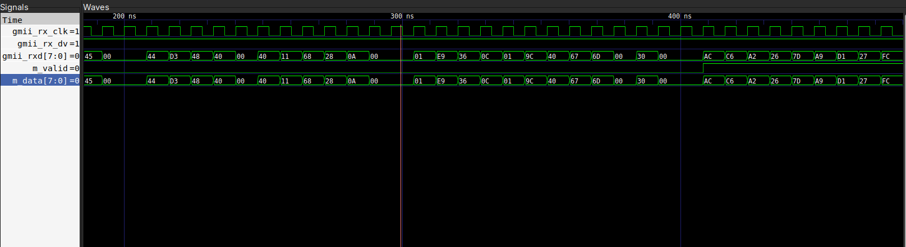

# Low Latency 1G Ethernet

[](https://github.com/devanandanj/low-latency-1g-ethernet/actions/workflows/tests.yml)

GMII to UDP payload in 0 added cycles. Plus a MAC TX.

Simulation only. Planned front end for a NASDAQ ITCH orderbook engine.

---

## Latency

| | |
|---|---|
| Logic, per payload byte | 0 cycles |
| Wire, before first payload byte | 400 ns |
| Frame verdict (`m_bad`) | 2 cycles after last byte |



Speculative cut-through: bytes are forwarded before the CRC is known.
The consumer rolls back on `m_bad`.

Earlier revisions: 2 cycles at the MAC. Store-and-forward would add
176 ns on a 64-byte frame.

Hardware will add 1 cycle for the pin register.

## Architecture

```
gmii_rxd -> ethernet_rx -> ethernet_parser -> ipv4_parser -> udp_parser -> payload
s_data   -> ethernet_tx -> gmii_txd
```

GMII, 8-bit at 125 MHz. Top level: `rtl/eth_stack.sv`.

## Verification

59 tests, 7 suites. Mutation-checked.

SystemVerilog, cocotb 1.9.2, Verilator 5.020.

```bash
pip install cocotb==1.9.2
cd tb/eth_stack && make
```

## Limits

- Not yet on an FPGA or a real PHY. No timing results.
- Bad frames are flagged, not blocked.
- No maximum-length or IP total length check.
- VLAN-tagged frames are dropped.
